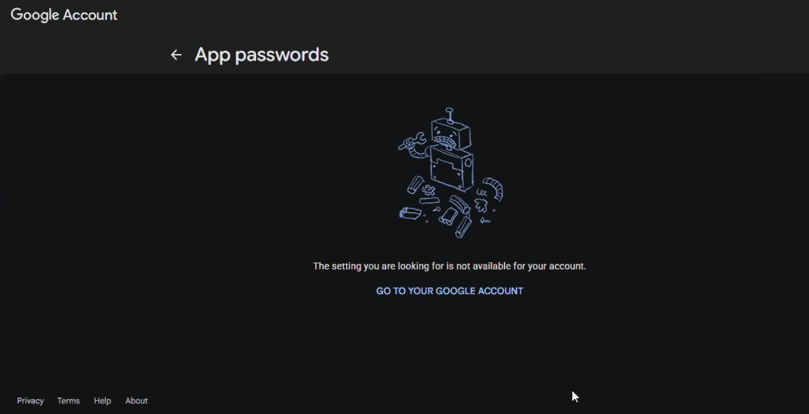
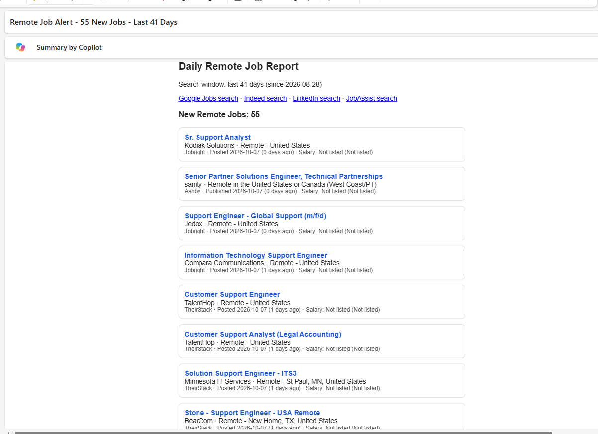

# Job Alert Bot

[](https://opensource.org/licenses/MIT)

A Python script that searches company job boards and selected job sites for **remote, US-eligible jobs** matching your chosen titles. It emails you a daily list of **new jobs you have not already been sent**.

The script was originally built for technical support and solutions engineering roles. You can customize the job titles, salary requirements, date range and company lists in `ats_job_alert.py`.

## Table of Contents

- [Requirements](#requirements)
- [What It Searches](#what-it-searches)
- [How Filtering Works](#how-filtering-works)
- [Quick Start](#quick-start)
- [Customize Your Search](#customize-your-search)
- [Optional Integrations](#optional-integrations)
- [Schedule Daily Runs](#schedule-daily-runs)
- [Files Created](#files-created)
- [Limitations and Security](#limitations-and-security)
- [Preview and Walkthrough](#preview-and-walkthrough)
- [License](#license)

## - Requirements

Before getting started, you will need:

- Windows, macOS or Linux.
- Python 3.10 or newer.
- Git.
- A Gmail account and Google App Password for email notifications.
- A terminal application:
  - **Windows:** PowerShell or the VS Code terminal.
  - **macOS:** Terminal or the VS Code terminal.

Optional:

- A TheirStack API key.
- Jobright or JobAssist accounts if you want to import saved job-search results.

**No third-party Python packages are required.** The script uses Python's standard library.

## - What It Searches

| Source | How It Works | Requirements |
|---|---|---|
| Greenhouse, Lever, and Ashby | Searches public company job-board APIs | Company lists configured in the script |
| Workable | Searches its public job-search endpoint and optional company boards | No API key |
| Remotive, Remote OK, and We Work Remotely | Reads public job feeds | No API key |
| TheirStack (optional) | Searches job listings across companies using its API | API key and available credits |
| Jobright and JobAssist (optional) | Processes job results exported from your logged-in browser session | Your own accounts and saved JSON files |

Source availability and job coverage may vary.

## - How Filtering Works

The script filters job listings using your configured settings:

- **Job titles:** Matches your selected keywords.
- **Work arrangement:** Targets remote positions and excludes hybrid or on-site roles.
- **Location:** Filters for US-eligible positions.
- **Posting date:** Checks jobs posted within `DAYS_BACK` days.
- **Salary:** Applies `MIN_SALARY` when a salary range is available.
- **Duplicate prevention:** Excludes jobs already recorded as emailed.

These filters are automated estimates, not guarantees. Always open the original job posting to verify the location, salary, remote-work eligibility, and application requirements.

## - Quick Start

Follow these steps in order. Windows and macOS instructions are provided where commands differ.

### Step 1: Create a Gmail App Password

The script uses Gmail to send job alerts.

1. Enable 2-Step Verification on your Google Account.
2. Visit the [Google App Passwords page](https://myaccount.google.com/apppasswords).
3. Generate an App Password.
4. Save it securely for the next step.

P.S: A `Google App Password` is different from your normal Google Account password.  

```bash
Note: If you see the message in the screenshot below, it may mean that 2-Step Verification is not enabled on your account. Set up 2FA before proceeding. Please, see helpful Google link below on how to "setup 2FA and create Google app password"
 ```

- [Set up 2-Step Verification](https://support.google.com/accounts/answer/185839)
- [Create and manage App Passwords](https://support.google.com/accounts/answer/185833)



### 2. Install Python and Git

#### Windows

1. Visit the [official Python downloads page](https://www.python.org/downloads/).
2. Download and install a supported Python 3 version compatible with the script.
3. If offered, select **Add Python to PATH** during installation.
   
    `Note: The default installation location is recommended. Alternatively, you can install Python in a dedicated directory on the C drive, such as C:\Python313\, if needed.`
4. Download and install Git from [git-scm.com](https://git-scm.com/downloads), if needed.

Open PowerShell and verify the installation:

```powershell
py --version or python --version
git --version
```

#### macOS

1. Visit the [official Python downloads page](https://www.python.org/downloads/) or install Python through Homebrew.
2. If you use Homebrew, run:

```bash
brew install python
```

3. Install Git if it is not already available.

Open Terminal and verify the installation:

```bash
python3 --version
git --version
```

**Note:** Python 3.10 or newer is required. Use a currently supported Python release that meets this requirement.

### 3. Clone the Repository

Cloning downloads the project files to your computer.

Open PowerShell on Windows or Terminal on macOS and run:

```bash
git clone https://github.com/ajfizzle/job-alert-bot.git
cd ats_job_alert
```

### Step 4: Configure Email Credentials

The script reads email credentials from environment variables rather than storing them in the source code.

Replace the example values below with your own Gmail address and App Password.

#### Windows - PowerShell

Run these commands in the same PowerShell window you will use to run the script:

```powershell
$env:JOB_ALERT_EMAIL_FROM = "you@gmail.com"
$env:JOB_ALERT_EMAIL_PASSWORD = "your16characterapppassword"
$env:JOB_ALERT_EMAIL_TO = "you@gmail.com"
```

`JOB_ALERT_EMAIL_TO` is the destination for job alerts. Use a comma-separated list if your script supports sending to multiple recipients.

These variables apply only to the current PowerShell session. If you close the window, you must set them again.

#### macOS - Terminal

Run these commands in the same Terminal session you will use to run the script:

```bash
export JOB_ALERT_EMAIL_FROM="you@gmail.com"
export JOB_ALERT_EMAIL_PASSWORD="your16characterapppassword"
export JOB_ALERT_EMAIL_TO="you@gmail.com"
```

These variables apply only to the current Terminal session.

**Security:** Never commit your Gmail App Password or API keys to GitHub. Avoid sharing screenshots or logs that expose credentials.

### Step 5: Test the Script

Run the script in dry-run mode before sending emails.

**macOS:** or **Windows:**

```bash
python3 ats_job_alert.py --dry-run -v
```

The `--dry-run` option lets you test the script without sending email. The `-v` option displays additional diagnostic information, including why jobs may have been excluded.

Review the results and make sure the job titles, locations, and filters match your expectations.

### Step 6: Run the Script

Once the dry run looks correct, run the script normally.

**macOS:** or **Windows:**

```bash
python3 ats_job_alert.py
```

The first successful run may email all currently eligible jobs. Subsequent runs should email only new jobs, based on the saved tracking data.

Keep the tracking files between runs to prevent duplicate alerts.

## - Customize Your Search

Open `ats_job_alert.py` in your preferred editor and look for the settings section near the top.

Common settings include:

| Setting | Purpose |
|---|---|
| `TITLE_KEYWORDS` | Job titles and keywords to search for |
| `MIN_SALARY` | Minimum salary requirement |
| `DAYS_BACK` | How far back to search for postings |
| `INCLUDE_SOLUTIONS_ENGINEERS` | Whether to include pre-sales Solutions Engineer roles |
| `COMPANIES` | Greenhouse company-board identifiers |
| `ASHBY_BOARDS` | Ashby company-board identifiers |
| `LEVER_BOARDS` | Lever company-board identifiers |
| `WORKABLE_BOARDS` | Workable company-board identifiers |

For example, a company's board identifier is typically the last part of its board URL:

- Greenhouse: `boards.greenhouse.io/COMPANY`
- Ashby: `jobs.ashbyhq.com/COMPANY`
- Lever: `jobs.lever.co/COMPANY`
- Workable: `apply.workable.com/COMPANY`

Use the identifier format expected by the script's settings. Not every company uses every platform.

### Discover More Company Boards

The `find_boards.py` script can help identify company job boards.

To use its built-in company list:

**macOS:** or **Windows:**

```bash
python3 find_boards.py
```

To provide your own list of company names, create a text file with one name per line, then run:

**macOS:** or **Windows:**

```bash
python3 find_boards.py my_names.txt
```

The script prints matching board identifiers that you can review and add to the appropriate settings in `ats_job_alert.py`.

## - Optional Integrations

### Jobright and JobAssist

These integrations use job-search results that you export yourself from your own logged-in browser session. The script does not log in to these services on your behalf.

General workflow:

1. Sign in to the relevant service using your browser.
2. Open the browser's Developer Tools, usually with `F12`.
3. Select the **Network** tab.
4. Find the request that returns the job listings.
5. If available, right-click the relevant request and select **Copy → Copy response**.
6. Save the response as `jobright.json` or `jobassist.json` in the project directory.
7. Run the main script to process the saved results.

The export procedure may vary by website and browser. Re-export the data periodically to refresh your results.

To inspect company boards found in a Jobright export:

```bash
python jobright_boards.py jobright.json
```

**Security warning:** These exports may contain account-related or other personal information. Do not commit them to GitHub or share them publicly. Confirm that they are covered by `.gitignore`.

### TheirStack

TheirStack is an optional source that uses an API key.

1. Create an account at [TheirStack](https://theirstack.com/).
2. Obtain an API key.
3. Set the `THEIRSTACK_API_KEY` environment variable.

**Windows PowerShell:**

```powershell
$env:THEIRSTACK_API_KEY = "your_api_key"
```

**macOS Terminal:**

```bash
export THEIRSTACK_API_KEY="your_api_key"
```

TheirStack usage may consume API credits. The script's credit tracking, caching, and request limits are intended to reduce unnecessary usage. Check TheirStack's current pricing, credit allowance, and API terms before using this integration.

Without a configured key, the optional source should be skipped.

## - Schedule Daily Runs

You can run the script manually or configure it to execute automatically.

### Option 1: Windows Task Scheduler

1. Open **Task Scheduler**.
2. Create a task with a daily trigger.
3. Configure the action to start a program.
4. Set the Python executable as the program.
5. Set the script path and working directory.
6. Make sure the required environment variables are available to the scheduled process.

If Python was installed through the Windows Python launcher, you can locate the Python executable with:

```powershell
py -c "import sys; print(sys.executable)"
```

Use that executable path in Task Scheduler. Ensure the task can access the project directory and that its credentials are available when it runs. Remember that environment variables created in an interactive PowerShell session are not automatically available to every scheduled task.

### Option 2: macOS or Linux Cron

Cron can run the script on a daily schedule. Use the full path to your Python executable and script.

For example, to run at 8:00 AM every weekday:

```cron
0 8 * * 1-5 /path/to/python /path/to/job-alert-bot-resume-tailored/ats_job_alert.py
```

Replace both paths with the actual paths on your computer.

Cron does not automatically inherit environment variables from your interactive terminal. Configure credentials securely for the scheduled process before relying on unattended runs.

### Option 3: GitHub Actions

GitHub Actions can run the script in the cloud, even when your computer is turned off.

1. Fork the repository or create your own copy.
2. Make your personal repository **private** if it will contain your job-tracking history.
3. Open **Settings → Secrets and variables → Actions**.
4. Add the following repository secrets:
   - `JOB_ALERT_EMAIL_FROM`
   - `JOB_ALERT_EMAIL_PASSWORD`
   - `JOB_ALERT_EMAIL_TO`
   - `THEIRSTACK_API_KEY` (optional)
5. Verify that the workflow passes these secrets to the script as environment variables.
6. Open the **Actions** tab and manually run the **Daily job alert** workflow to test it.

The workflow must pass these secrets to the script as environment variables. It must also preserve the job-tracking files between runs if you want to avoid repeat alerts.

Depending on the repository's workflow configuration, you may need to enable write permissions or configure a separate persistence mechanism to save updated tracking data.

**Important:** GitHub Actions cannot use your local Jobright or JobAssist export files unless you upload them to the workflow environment. Do not commit sensitive exports to the repository just to make those integrations work.

## - Files Created

The script may create or update the following files:

| File | Purpose |
|---|---|
| `seen_jobs.txt` | Tracks jobs that have already been emailed |
| `jobs.csv` | Stores job information, depending on the script configuration |
| `job_alert.log` | Records run details and diagnostic messages |
| `theirstack_usage.json` | Tracks TheirStack API usage |
| `theirstack_cache.json` | Caches recent TheirStack results |

Keep the job-tracking files between runs to prevent duplicates.

Check `.gitignore` to confirm which generated files are excluded from Git. Excluding a file from Git does not remove it from a repository if it was committed previously.

## - Limitations and Security

- **GitHub security rule of thumb:** Before deploying to public repo, check that it contains no sensitive information, such as passwords, API keys, email credentials, personal data or private job-search exports. Add sensitive files to `.gitignore` before committing them. Remember that `.gitignore` does not remove files that have already been committed or pushed to GitHub. If sensitive information has been exposed, remove it from the repository as appropriate and immediately rotate or revoke the affected credentials.
- **US remote jobs:** The default filters target jobs eligible for applicants in the United States. Other regions may require changes to the filtering logic.
- **Source availability:** Job boards and APIs can change, become unavailable, or return incomplete results.
- **Workable:** Its search integration may rely on an undocumented public endpoint that can change without notice.
- **Salary information:** Listings without salary information may not be filtered reliably by compensation.
- **Remote eligibility:** Always verify the original job posting before applying.
- **Run frequency:** Once per day is generally sufficient for a personal job search. Respect each source's terms and rate limits.
- **FlexJobs:** Not supported through a public job-seeker API.
- **Privacy:** Treat exports, logs and tracking files as potentially sensitive.
- **No affiliation:** This project is not affiliated with Greenhouse, Lever, Ashby, Workable, TheirStack, Jobright, JobAssist or any listed employer.

## - Preview and Walkthrough
Here is a preview of email received:



## - License

This project is licensed under the [MIT License](LICENSE).

## Note

Feel free to modify this script to better suit your job search. All the best, and I hope it helps you land your dream job! 🙏
